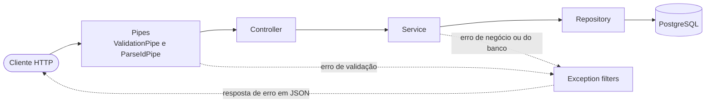
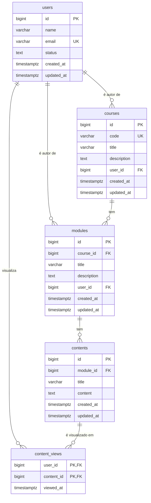

# Course Management API

API REST para gerenciar uma plataforma de cursos online: **usuários**, **cursos**, **módulos** e **conteúdos** (aulas), além de **relatórios** gerados com SQL. Construída com **NestJS** e **TypeScript**, com **PostgreSQL** como banco de dados.


As consultas da API são escritas em **SQL puro** com o driver `pg` (node-postgres). O **Knex** é usado só para criar as tabelas (migrations) e popular o banco com dados de exemplo (seeds).

## Sumário

- [Funcionalidades](#funcionalidades)
- [Tecnologias](#tecnologias)
- [Como executar](#como-executar)
- [Variáveis de ambiente](#variáveis-de-ambiente)
- [Scripts disponíveis](#scripts-disponíveis)
- [Como funciona](#como-funciona)
- [Banco de dados](#banco-de-dados)
- [Endpoints da API](#endpoints-da-api)
- [Relatórios](#relatórios)
- [Testando a API com curl](#testando-a-api-com-curl)
- [Solução de problemas](#solução-de-problemas)
- [Próximos passos](#próximos-passos)

## Funcionalidades

- **CRUD completo** de usuários, cursos, módulos e conteúdos (`GET`, `POST`, `PATCH`, `DELETE`).
- **5 relatórios em SQL**: ranking de usuários por número de cursos, curso com mais conteúdos, visão geral dos cursos, conteúdos com seu módulo e curso, e quem visualizou cada conteúdo.
- **Validação automática** do corpo das requisições com `class-validator`. Campos desconhecidos são rejeitados.
- **Erros padronizados** (`400`, `404`, `409`): erros do PostgreSQL (e-mail duplicado, registro relacionado inexistente etc.) viram respostas HTTP claras.
- **Migrations e seeds** para criar o banco e preenchê-lo com dados de exemplo.
- **Docker Compose** para subir o PostgreSQL com um único comando.

## Tecnologias

| Tecnologia | Versão | Papel no projeto |
| --- | --- | --- |
| [Node.js](https://nodejs.org/) | 22+ | Ambiente de execução |
| [TypeScript](https://www.typescriptlang.org/) | 6 | Linguagem (projeto em ES Modules) |
| [NestJS](https://nestjs.com/) | 12 | Framework da API (roda sobre o Express 5) |
| [PostgreSQL](https://www.postgresql.org/) | 18 (Docker) | Banco de dados |
| [pg (node-postgres)](https://node-postgres.com/) | 8 | Driver do PostgreSQL: executa as queries SQL da API |
| [Knex](https://knexjs.org/) | 3 | Migrations e seeds (usado só pela linha de comando) |
| [class-validator](https://github.com/typestack/class-validator) / class-transformer | 0.15 / 0.5 | Validação dos DTOs |
| [@nestjs/config](https://docs.nestjs.com/techniques/configuration) | 12 | Leitura das variáveis do `.env` |
| [tsx](https://tsx.is/) | 4 | Executa arquivos TypeScript sem um passo de build (usado pela CLI do Knex) |
| [Docker Compose](https://docs.docker.com/compose/) | — | Sobe o container do PostgreSQL |

## Como executar

### Pré-requisitos

- **Node.js 22 ou superior** (o npm vem junto)
- **Docker** com **Docker Compose**, ou um **PostgreSQL 13+** instalado na máquina
- **Git**

Para conferir as versões instaladas:

```bash
node -v
npm -v
docker compose version
```

### 1. Clone o repositório e instale as dependências

```bash
git clone https://github.com/LxzCunha/course-management.git
cd course-management
npm install
```

### 2. Crie o arquivo `.env`

Na raiz do projeto, crie um arquivo chamado `.env` com o conteúdo abaixo:

```dotenv
# Banco de dados (usado pelo Docker Compose, pelas migrations e pela API)
DB_HOST=localhost
DB_PORT=5432
DB_USER=postgres
DB_PASSWORD=postgres
DB_NAME=course_management

# Porta da API (opcional, padrão 3000)
PORT=3000
```

> [!IMPORTANT]
> Crie o `.env` **antes** de subir o banco: o Docker Compose lê esse arquivo para definir usuário, senha, nome do banco e porta do container. O `.env` está no `.gitignore`, então não vai para o repositório. Os valores acima servem só para desenvolvimento local.

### 3. Suba o PostgreSQL com Docker

```bash
docker compose up -d
```

Esse comando cria o container `course-management-db` (PostgreSQL 18) e um volume do Docker (declarado como `pgdata` no `docker-compose.yml`), onde os dados ficam guardados. Para conferir se o banco está pronto, rode o comando abaixo e espere o status aparecer como `healthy`:

```bash
docker compose ps
```

### 4. Crie as tabelas (migrations)

```bash
npm run migrate:latest
```

Saída esperada: `Batch 1 run: 5 migrations`.

### 5. Popule o banco com dados de exemplo (seeds)

```bash
npm run seed:run
```

Saída esperada: `Ran 5 seed files`.

> [!WARNING]
> Os seeds **apagam todos os dados** das tabelas antes de inserir os exemplos (`TRUNCATE ... RESTART IDENTITY CASCADE`). Isso é útil para "resetar" o banco, mas tudo o que você tiver criado pela API será perdido.

### 6. Inicie a API

```bash
npm run start:dev
```

Quando aparecer `Nest application successfully started` no terminal, a API estará disponível em **http://localhost:3000**. Nesse modo, cada alteração salva no código faz a aplicação recompilar e reiniciar sozinha.

### 7. Teste

```bash
curl http://localhost:3000/courses
```

Você também pode abrir http://localhost:3000/reports/courses-overview no navegador. Mais exemplos em [Testando a API com curl](#testando-a-api-com-curl).

### Resumo dos comandos

```bash
git clone https://github.com/LxzCunha/course-management.git
cd course-management
npm install
# crie o arquivo .env (passo 2)
docker compose up -d
npm run migrate:latest
npm run seed:run
npm run start:dev
```

### Rodando sem Docker (PostgreSQL instalado na máquina)

1. Crie o banco de dados, pelo `psql`, pgAdmin ou DBeaver:

   ```sql
   CREATE DATABASE course_management;
   ```

2. Ajuste `DB_USER`, `DB_PASSWORD`, `DB_PORT` e `DB_NAME` no `.env` com os dados da sua instalação.
3. Continue a partir do [passo 4](#4-crie-as-tabelas-migrations).

> [!NOTE]
> Use o PostgreSQL 13 ou mais recente: um dos relatórios usa `FETCH FIRST ... WITH TIES`, recurso que só existe a partir dessa versão.

### Build de produção

```bash
npm run build       # compila o TypeScript para JavaScript na pasta dist/
npm run start:prod  # executa a versão compilada (node dist/server)
```

- O build contém **só a API**. Migrations, seeds e `knexfile.ts` ficam de fora (veja o `tsconfig.build.json`) e rodam direto do TypeScript com o `tsx`. Por isso os comandos `migrate:*` e `seed:*` precisam do código-fonte e das dependências de desenvolvimento.
- Em produção, as variáveis podem ser definidas direto no ambiente, sem `.env`, porque a API também lê `process.env`. Já os scripts do Knex exigem o arquivo `.env`.

## Variáveis de ambiente

| Variável | Obrigatória | Exemplo | Descrição |
| --- | --- | --- | --- |
| `DB_HOST` | Sim | `localhost` | Endereço do PostgreSQL |
| `DB_PORT` | Sim | `5432` | Porta do PostgreSQL. Com Docker, é também a porta publicada na sua máquina |
| `DB_USER` | Sim | `postgres` | Usuário do banco |
| `DB_PASSWORD` | Sim | `postgres` | Senha do banco |
| `DB_NAME` | Sim | `course_management` | Nome do banco |
| `PORT` | Não | `3000` | Porta HTTP da API (padrão: `3000`) |

O mesmo `.env` é lido por três partes do projeto:

1. **Docker Compose**, para configurar o container (`POSTGRES_USER`, `POSTGRES_PASSWORD`, `POSTGRES_DB` e a porta publicada).
2. **CLI do Knex**, pelo `tsx --env-file=.env` nos scripts `migrate:*` e `seed:*`.
3. **API**, pelo `ConfigModule` do NestJS. Se faltar alguma variável `DB_*`, a API não sobe e mostra um erro como `Configuration key "DB_HOST" does not exist`.

## Scripts disponíveis

| Comando | O que faz |
| --- | --- |
| `npm run start:dev` | Inicia a API em modo desenvolvimento, reiniciando a cada alteração (watch) |
| `npm run start` | Compila e inicia a API uma vez, sem watch |
| `npm run start:debug` | Igual ao `start:dev`, mas com o inspetor do Node ativo para depuração (porta padrão 9229) |
| `npm run build` | Compila o projeto para `dist/` |
| `npm run start:prod` | Executa a versão compilada (rode o `build` antes) |
| `npm run migrate:latest` | Executa as migrations pendentes |
| `npm run migrate:rollback` | Desfaz o último lote (*batch*) de migrations. Use `npm run migrate:rollback -- --all` para desfazer todas |
| `npm run migrate:make -- <nome>` | Cria um arquivo de migration em `src/database/migrations` |
| `npm run seed:run` | Executa os seeds (apaga e recria os dados de exemplo) |
| `npm run seed:make -- <nome>` | Cria um arquivo de seed em `src/database/seeds` |
| `npm run knex -- <comando>` | Executa qualquer comando da CLI do Knex, por exemplo `npm run knex -- migrate:status` |

> [!TIP]
> O `--` antes do nome faz o npm repassar o argumento para o script. Exemplo: `npm run migrate:make -- create_enrollments`.

Para recriar o banco do zero:

```bash
npm run migrate:rollback -- --all
npm run migrate:latest
npm run seed:run
```

## Como funciona

### Visão geral do domínio

Um **usuário** pode ser autor de **cursos**. Cada curso é dividido em **módulos**, e cada módulo tem **conteúdos** (as aulas). A tabela `content_views` registra quais usuários visualizaram quais conteúdos e é a base do relatório de visualizações.

### Arquitetura em camadas

O código segue a arquitetura **Controller → Service → Repository**, o mesmo padrão de frameworks como o Spring Boot:



| Camada | Pasta | Responsabilidade |
| --- | --- | --- |
| **Controller** | `src/controller` | Define as rotas HTTP (`@Get`, `@Post`, `@Patch`, `@Delete`), recebe parâmetros e corpo e chama o service. Não contém regra de negócio. |
| **Service** | `src/service` | Regras de negócio: lança `NotFoundError` quando o registro não existe e traduz erros do PostgreSQL em erros HTTP. |
| **Repository** | `src/repository` | Acesso ao banco com SQL puro e parametrizado, usando o pool de conexões do `pg`. |
| **DTO** | `src/dto` | Formato e regras de validação do corpo das requisições (`class-validator`). |
| **Models** | `src/models` | Tipos TypeScript das entidades e dos resultados dos relatórios. |
| **Pipes** | `src/pipes` | `ParseIdPipe`: converte o `:id` da URL para número e rejeita valores que não sejam inteiros. |
| **Errors** | `src/errors` | Erros customizados (`NotFoundError`, `ValidationError`), filtros que os transformam em respostas HTTP e funções que identificam erros do PostgreSQL. |

As classes se conectam por **injeção de dependência** do NestJS: cada uma recebe o que precisa pelo construtor (o `CoursesService`, por exemplo, recebe o `CoursesRepository`), e todas são registradas no `AppModule`.

### O caminho de uma requisição

Exemplo: `POST /courses` com o corpo `{"code": "REACT-101", "title": "React do Zero", "userId": 6}`.

1. O **`ValidationPipe`** global (configurado em `server.ts`) valida o corpo contra o `CreateCourseDto`. Se faltar campo, o tipo estiver errado ou houver campo desconhecido, a requisição para aqui com `400`.
2. **`CoursesController.create()`** recebe o corpo já validado e chama `CoursesService.create()`.
3. **`CoursesService`** chama `CoursesRepository.create()`, que executa um `INSERT ... RETURNING` no PostgreSQL.
4. Se o banco recusar a operação, o service traduz o erro:
   - código já usado por outro curso (violação de unicidade) → `409 Conflict`: `Course code REACT-101 is already in use`;
   - usuário inexistente (violação de chave estrangeira) → `400 Bad Request`: `User 6 does not exist`.
5. Se tudo der certo, a API responde `201 Created` com o curso criado em JSON.

### Estrutura de pastas

```text
course-management/
├── docker-compose.yml          # Container do PostgreSQL 18
├── nest-cli.json               # Configuração do Nest CLI (ponto de entrada: server)
├── package.json                # Dependências e scripts npm
├── tsconfig.json               # Configuração do TypeScript
├── tsconfig.build.json         # Build: exclui migrations, seeds e knexfile
└── src/
    ├── server.ts               # Ponto de entrada: cria a app, registra pipes e filtros globais e sobe o servidor
    ├── AppModule.ts            # Módulo raiz: registra controllers, services e repositories
    ├── app.ts                  # Arquivo vazio (não é usado)
    ├── controller/             # Rotas HTTP: Users, Courses, Modules, Contents e Reports
    ├── service/                # Regras de negócio e tradução de erros do banco
    ├── repository/             # Queries SQL com o pg
    ├── dto/                    # Dados de entrada e regras de validação (Create*Dto, Update*Dto)
    ├── models/                 # Tipos das entidades e dos relatórios
    ├── pipes/                  # ParseIdPipe
    ├── errors/                 # NotFoundError, ValidationError, filtros e helpers de erros do PostgreSQL
    └── database/
        ├── DatabaseModule.ts   # Pool de conexões do pg, disponível para toda a app (token PG_POOL)
        ├── knexfile.ts         # Configuração do Knex (usada só pela CLI)
        ├── migrations/         # Criação das tabelas
        └── seeds/              # Dados de exemplo
```

### Validação dos dados

- O `ValidationPipe` usa `whitelist` e `forbidNonWhitelisted`: qualquer campo que não exista no DTO gera erro (`property idade should not exist`).
- Não há conversão automática de tipos. `"userId": "2"` (string) é rejeitado; envie `"userId": 2`.
- O `:id` da URL passa pelo `ParseIdPipe`: `GET /users/abc` retorna `400` com `Validation failed (numeric string is expected)`.
- Os DTOs de atualização (`Update*Dto`) são criados com `PartialType`, que deixa todos os campos opcionais. As regras continuam valendo para os campos enviados.

### Atualização parcial (`PATCH`)

- Só os campos enviados são alterados. Os demais continuam como estão (o SQL usa `COALESCE`).
- `null` em um campo obrigatório, como `title`, é ignorado e o valor atual é mantido.
- Em `description` (cursos e módulos), `null` **apaga** a descrição.
- `updatedAt` é atualizado em todo `PATCH`, mesmo com corpo vazio (`{}`).

### Tratamento de erros

As respostas de erro seguem este formato:

```json
{
  "message": "Course 42 not found",
  "error": "Not Found",
  "statusCode": 404
}
```

O campo `message` pode ser um texto ou uma **lista de textos**: na validação do corpo, a API devolve todos os problemas encontrados de uma vez.

| Situação | Status | Exemplo de `message` |
| --- | --- | --- |
| Corpo inválido | `400` | `["name should not be empty", "email must be an email"]` |
| Campo desconhecido no corpo | `400` | `["property idade should not exist"]` |
| `:id` não numérico na URL | `400` | `"Validation failed (numeric string is expected)"` |
| `userId`, `courseId` ou `moduleId` inexistente | `400` | `"User 999 does not exist"`, `"Course 999 does not exist"`, `"Module 999 does not exist"` |
| Registro não encontrado | `404` | `"Course 42 not found"` |
| Rota inexistente | `404` | `"Cannot GET /nao-existe"` |
| E-mail ou código de curso já usado | `409` | `"Email ana.souza@example.com is already in use"`, `"Course code NODE-101 is already in use"` |
| Excluir usuário que é autor de cursos ou módulos | `409` | `"User 1 has courses or modules and cannot be deleted"` |
| Erro inesperado (ex.: banco fora do ar) | `500` | `"Internal server error"` (essa resposta não tem o campo `error`) |

Como isso é implementado:

- `NotFoundError` é convertido em `404` pelo `NotFoundErrorFilter`.
- `ValidationError` é convertido em `400` pelo `ValidationErrorFilter`. Ele é lançado pelo `ValidationPipe`, pelo `ParseIdPipe` e pelos services quando um registro relacionado não existe.
- Conflitos usam a `ConflictException` do próprio NestJS (`409`).
- `src/errors/DatabaseErrors.ts` identifica os erros do PostgreSQL pelo código: `23505` (valor único repetido) e `23503`/`23001` (violação de chave estrangeira).
- Qualquer outro erro vira `500` pelo filtro padrão do NestJS.

### Detalhes de implementação

- **SQL parametrizado**: os valores nunca são concatenados na query. Eles vão como parâmetros (`$1`, `$2`…), o que protege contra SQL injection.
- **snake_case → camelCase**: as colunas do banco usam `snake_case` (`user_id`), e as queries usam aliases (`user_id AS "userId"`) para a API responder em `camelCase`.
- **IDs como número**: o PostgreSQL usa `BIGINT` em IDs e contagens, e o `pg` retornaria esses valores como string. O `DatabaseModule` registra um *type parser* que os converte para `number`.
- **Pool de conexões**: o `DatabaseModule` cria um `Pool` do `pg` compartilhado pela aplicação inteira. A conexão só é aberta na primeira query, e o pool é fechado quando a API é encerrada (`enableShutdownHooks` + `onApplicationShutdown`).
- **ES Modules**: o projeto usa `"type": "module"`, por isso os imports internos terminam em `.js` mesmo nos arquivos `.ts` (ex.: `import { AppModule } from "./AppModule.js"`).

## Banco de dados

### Modelo de dados



| Tabela | O que guarda | Colunas e regras principais |
| --- | --- | --- |
| `users` | Usuários | `name` (até 150 caracteres), `email` (único), `status` (`active` ou `inactive`, padrão `active`) |
| `courses` | Cursos | `code` (único, até 50 caracteres), `title`, `description` (opcional), `user_id` (autor) |
| `modules` | Módulos de um curso | `course_id`, `title`, `description` (opcional), `user_id` (autor) |
| `contents` | Conteúdos (aulas) de um módulo | `module_id`, `title`, `content` (texto da aula) |
| `content_views` | Qual usuário visualizou qual conteúdo | `user_id`, `content_id`, `viewed_at` |

Todas as tabelas, exceto `content_views`, têm `id` (`BIGINT` autoincremental), `created_at` e `updated_at`. Em `content_views`, a chave primária é composta por (`user_id`, `content_id`), então cada usuário aparece no máximo uma vez por conteúdo.

### O que acontece ao excluir

| Ao excluir… | Efeito |
| --- | --- |
| um **usuário** | Bloqueado (`409`) se ele for autor de algum curso ou módulo (`ON DELETE RESTRICT`). Se não for, ele é excluído junto com as visualizações dele. |
| um **curso** | Os módulos do curso, os conteúdos desses módulos e as visualizações desses conteúdos são excluídos em cascata (`ON DELETE CASCADE`). |
| um **módulo** | Os conteúdos do módulo e as visualizações deles são excluídos em cascata. |
| um **conteúdo** | As visualizações do conteúdo são excluídas em cascata. |

### Migrations

Ficam em `src/database/migrations` e rodam na ordem do timestamp no nome do arquivo. O Knex registra as que já rodaram na tabela `knex_migrations`, então `migrate:latest` só executa as pendentes.

| Migration | Cria a tabela |
| --- | --- |
| `20261030165756_create_users.ts` | `users` |
| `20261030165757_create_courses.ts` | `courses` |
| `20261030165758_create_modules.ts` | `modules` |
| `20261030165759_create_contents.ts` | `contents` |
| `20261030170806_create_content_views.ts` | `content_views` |

### Seeds (dados de exemplo)

Ficam em `src/database/seeds` e rodam em ordem alfabética (por isso o prefixo `01_`, `02_`…), porque cada seed usa os dados do anterior:

| Seed | Insere |
| --- | --- |
| `01_users.ts` | 5 usuários: Ana, Bruno, Carla, Diego e Elisa (esta com status `inactive`) |
| `02_courses.ts` | 5 cursos: `NODE-101`, `TS-101`, `SQL-101`, `GIT-101` e `DOCKER-101` (Ana é autora de dois) |
| `03_modules.ts` | 10 módulos: 5 em `NODE-101`, 3 em `TS-101` e 2 em `SQL-101` (`GIT-101` e `DOCKER-101` ficam sem módulos) |
| `04_contents.ts` | 12 conteúdos distribuídos entre os módulos |
| `05_content_views.ts` | 9 visualizações de conteúdo |

> [!NOTE]
> Por enquanto, as visualizações (`content_views`) só são criadas pelos seeds. A API ainda não tem um endpoint para registrar visualizações.

### Acessando o banco

Para abrir o terminal do PostgreSQL dentro do container (com os valores do `.env` de exemplo):

```bash
docker exec -it course-management-db psql -U postgres -d course_management
```

Dentro do `psql`, `\dt` lista as tabelas, `SELECT * FROM courses;` mostra os cursos e `\q` sai. Se preferir uma interface gráfica, conecte o DBeaver ou o pgAdmin em `localhost:5432` com o usuário e a senha do `.env`.

## Endpoints da API

- **URL base:** `http://localhost:3000`
- Requisições e respostas em **JSON**. Envie o header `Content-Type: application/json` no `POST` e no `PATCH`.
- Campos em `camelCase`. Datas em ISO 8601, no fuso UTC (ex.: `2026-10-31T00:53:31.463Z`).
- As listagens retornam todos os registros, ordenados por `id`, sem paginação.
- Não há autenticação.

### Rotas de CRUD

Os quatro recursos (`users`, `courses`, `modules` e `contents`) têm as mesmas rotas:

| Método | Rota | O que faz | Sucesso |
| --- | --- | --- | --- |
| `GET` | `/{recurso}` | Lista todos os registros | `200` |
| `GET` | `/{recurso}/:id` | Busca um registro pelo ID | `200` |
| `POST` | `/{recurso}` | Cria um registro | `201` |
| `PATCH` | `/{recurso}/:id` | Atualiza parte dos campos | `200` |
| `DELETE` | `/{recurso}/:id` | Exclui um registro (resposta sem corpo) | `204` |

Exemplos: `GET /courses/1`, `PATCH /users/2`, `DELETE /modules/3`.

### Usuários: `/users`

| Campo | Tipo | Obrigatório no `POST` | Regras |
| --- | --- | --- | --- |
| `name` | string | Sim | Não pode ser vazio; até 150 caracteres |
| `email` | string | Sim | E-mail válido; até 255 caracteres; não pode repetir |
| `status` | string | Não | `"active"` ou `"inactive"` (padrão: `"active"`) |

```json
{
  "id": 6,
  "name": "Fernanda Alves",
  "email": "fernanda@example.com",
  "status": "active",
  "createdAt": "2026-10-31T00:53:31.463Z",
  "updatedAt": "2026-10-31T00:53:31.463Z"
}
```

### Cursos: `/courses`

| Campo | Tipo | Obrigatório no `POST` | Regras |
| --- | --- | --- | --- |
| `code` | string | Sim | Não pode ser vazio; até 50 caracteres; não pode repetir (ex.: `REACT-101`) |
| `title` | string | Sim | Não pode ser vazio; até 255 caracteres |
| `description` | string ou `null` | Não | Texto livre |
| `userId` | inteiro | Sim | Maior que zero; o usuário (autor) precisa existir |

```json
{
  "id": 6,
  "code": "REACT-101",
  "title": "React do Zero",
  "description": "Componentes, props e hooks.",
  "userId": 6,
  "createdAt": "2026-10-31T00:53:31.482Z",
  "updatedAt": "2026-10-31T00:53:31.482Z"
}
```

### Módulos: `/modules`

| Campo | Tipo | Obrigatório no `POST` | Regras |
| --- | --- | --- | --- |
| `courseId` | inteiro | Sim | Maior que zero; o curso precisa existir |
| `title` | string | Sim | Não pode ser vazio; até 255 caracteres |
| `description` | string ou `null` | Não | Texto livre |
| `userId` | inteiro | Sim | Maior que zero; o usuário (autor) precisa existir |

```json
{
  "id": 11,
  "courseId": 6,
  "title": "Hooks",
  "description": "useState e useEffect.",
  "userId": 6,
  "createdAt": "2026-10-31T00:53:31.497Z",
  "updatedAt": "2026-10-31T00:53:31.497Z"
}
```

### Conteúdos: `/contents`

| Campo | Tipo | Obrigatório no `POST` | Regras |
| --- | --- | --- | --- |
| `moduleId` | inteiro | Sim | Maior que zero; o módulo precisa existir |
| `title` | string | Sim | Não pode ser vazio; até 255 caracteres |
| `content` | string | Sim | Não pode ser vazio (texto da aula) |

```json
{
  "id": 13,
  "moduleId": 11,
  "title": "Entendendo o useState",
  "content": "useState guarda um valor que, quando muda, faz o componente renderizar de novo.",
  "createdAt": "2026-10-31T00:53:31.511Z",
  "updatedAt": "2026-10-31T00:53:31.511Z"
}
```

## Relatórios

Rotas somente leitura (`GET`) em `/reports`. Os exemplos abaixo usam os dados dos seeds.

| Rota | O que retorna |
| --- | --- |
| `GET /reports/users-with-most-courses` | Ranking dos usuários pela quantidade de cursos de que são autores |
| `GET /reports/courses-with-most-contents` | O curso (ou os cursos, em caso de empate) com mais conteúdos |
| `GET /reports/courses-overview` | Todos os cursos, com a quantidade de módulos e de conteúdos |
| `GET /reports/contents` | Todos os conteúdos, com o título do módulo e do curso |
| `GET /reports/contents/:contentId/viewers` | Os usuários que visualizaram um conteúdo |

### `GET /reports/users-with-most-courses`

Lista **todos** os usuários com `courseCount` (número de cursos) e `rank` (posição). O `LEFT JOIN` faz os usuários sem cursos aparecerem com `0`. A função de janela `RANK()` coloca empatados na mesma posição, e a posição seguinte "pula" (1, 2, 2, 2, 5). A lista é ordenada pela posição e depois pelo nome.

```json
[
  { "id": 1, "name": "Ana Souza", "email": "ana.souza@example.com", "courseCount": 2, "rank": 1 },
  { "id": 2, "name": "Bruno Lima", "email": "bruno.lima@example.com", "courseCount": 1, "rank": 2 },
  { "id": 3, "name": "Carla Mendes", "email": "carla.mendes@example.com", "courseCount": 1, "rank": 2 },
  { "id": 4, "name": "Diego Santos", "email": "diego.santos@example.com", "courseCount": 1, "rank": 2 },
  { "id": 5, "name": "Elisa Rocha", "email": "elisa.rocha@example.com", "courseCount": 0, "rank": 5 }
]
```

### `GET /reports/courses-with-most-contents`

Retorna o curso com mais conteúdos. A query usa `FETCH FIRST 1 ROWS WITH TIES`: se houver empate no primeiro lugar, todos os empatados vêm na resposta, que por isso é sempre uma lista. Cursos sem conteúdos não entram, e a lista fica vazia se não houver nenhum conteúdo cadastrado.

```json
[
  { "id": 2, "code": "TS-101", "title": "TypeScript in Practice", "contentCount": 5 }
]
```

### `GET /reports/courses-overview`

Todos os cursos com `moduleCount` e `contentCount`, ordenados por `id`. Cursos sem módulos aparecem com `0` (`LEFT JOIN` + `COUNT(DISTINCT ...)`).

```json
[
  { "id": 1, "code": "NODE-101", "title": "Node.js from Scratch", "moduleCount": 5, "contentCount": 3 },
  { "id": 2, "code": "TS-101", "title": "TypeScript in Practice", "moduleCount": 3, "contentCount": 5 },
  { "id": 3, "code": "SQL-101", "title": "SQL Fundamentals with PostgreSQL", "moduleCount": 2, "contentCount": 4 },
  { "id": 4, "code": "GIT-101", "title": "Git and GitHub", "moduleCount": 0, "contentCount": 0 },
  { "id": 5, "code": "DOCKER-101", "title": "Docker for Developers", "moduleCount": 0, "contentCount": 0 }
]
```

### `GET /reports/contents`

Cada conteúdo com `moduleTitle` e `courseTitle`, ordenados por curso, módulo e conteúdo. Abaixo, os 3 primeiros dos 12 itens dos seeds:

```json
[
  { "id": 1, "title": "What is Node.js", "moduleTitle": "Introduction to Node.js", "courseTitle": "Node.js from Scratch" },
  { "id": 2, "title": "Installing packages with npm", "moduleTitle": "Modules and npm", "courseTitle": "Node.js from Scratch" },
  { "id": 3, "title": "Understanding Promises", "moduleTitle": "Asynchronous programming", "courseTitle": "Node.js from Scratch" }
]
```

### `GET /reports/contents/:contentId/viewers`

Os usuários que visualizaram o conteúdo, com a data da visualização (`viewedAt`), ordenados pela data e depois pelo nome. Retorna `404` se o conteúdo não existir e `[]` se ninguém o visualizou.

Exemplo: `GET /reports/contents/1/viewers`

```json
[
  { "id": 2, "name": "Bruno Lima", "email": "bruno.lima@example.com", "viewedAt": "2026-10-31T00:49:11.602Z" },
  { "id": 3, "name": "Carla Mendes", "email": "carla.mendes@example.com", "viewedAt": "2026-10-31T00:49:11.602Z" },
  { "id": 4, "name": "Diego Santos", "email": "diego.santos@example.com", "viewedAt": "2026-10-31T00:49:11.602Z" }
]
```

## Testando a API com curl

Um fluxo completo, partindo dos dados dos seeds. Os IDs podem ser diferentes se você já tiver criado ou excluído registros, então use os que a API devolver. A opção `-i` mostra o status HTTP da resposta.

```bash
# 1. Criar uma usuária (autora)
curl -X POST http://localhost:3000/users \
  -H "Content-Type: application/json" \
  -d '{"name": "Fernanda Alves", "email": "fernanda@example.com"}'
# → 201, com "id": 6

# 2. Criar um curso dela
curl -X POST http://localhost:3000/courses \
  -H "Content-Type: application/json" \
  -d '{"code": "REACT-101", "title": "React do Zero", "description": "Componentes, props e hooks.", "userId": 6}'
# → 201, com "id": 6

# 3. Criar um módulo no curso
curl -X POST http://localhost:3000/modules \
  -H "Content-Type: application/json" \
  -d '{"courseId": 6, "title": "Hooks", "description": "useState e useEffect.", "userId": 6}'
# → 201, com "id": 11

# 4. Criar um conteúdo no módulo
curl -X POST http://localhost:3000/contents \
  -H "Content-Type: application/json" \
  -d '{"moduleId": 11, "title": "Entendendo o useState", "content": "useState guarda um valor que, quando muda, faz o componente renderizar de novo."}'
# → 201, com "id": 13

# 5. Alterar só o título do curso
curl -X PATCH http://localhost:3000/courses/6 \
  -H "Content-Type: application/json" \
  -d '{"title": "React na Prática"}'
# → 200, com o curso atualizado

# 6. Ver o curso novo no relatório geral
curl http://localhost:3000/reports/courses-overview
# → [..., {"id": 6, "code": "REACT-101", "title": "React na Prática", "moduleCount": 1, "contentCount": 1}]

# 7. Tentar excluir a autora: bloqueado, porque ela tem um curso
curl -i -X DELETE http://localhost:3000/users/6
# → 409 {"message": "User 6 has courses or modules and cannot be deleted", ...}

# 8. Excluir o curso (o módulo e o conteúdo vão junto) e depois a usuária
curl -i -X DELETE http://localhost:3000/courses/6   # → 204
curl -i -X DELETE http://localhost:3000/users/6     # → 204
```

Exemplo de erro de validação:

```bash
curl -X POST http://localhost:3000/users \
  -H "Content-Type: application/json" \
  -d '{"name": "", "email": "nao-e-email", "idade": 30}'
```

```json
{
  "message": [
    "property idade should not exist",
    "name should not be empty",
    "email must be an email"
  ],
  "error": "Bad Request",
  "statusCode": 400
}
```

> [!TIP]
> **No Windows**, rode os exemplos no **Git Bash** ou no **WSL**. No PowerShell, `curl` pode ser um apelido de outro comando e as aspas do JSON se comportam de outro jeito. Outra opção é usar um cliente HTTP como Postman, Insomnia ou a extensão Thunder Client do VS Code.

## Solução de problemas

| Problema | Causa provável | Solução |
| --- | --- | --- |
| `node: .env: not found` ao rodar migrations ou seeds | Não existe `.env` na raiz do projeto | Crie o `.env` ([passo 2](#2-crie-o-arquivo-env)) e rode o comando na raiz do projeto |
| A API não sobe: `Configuration key "DB_HOST" does not exist` | `.env` ausente ou incompleto | Confira se todas as variáveis `DB_*` estão no `.env` |
| `500 Internal server error` nas requisições e `connect ECONNREFUSED 127.0.0.1:5432` no terminal | O PostgreSQL não está rodando. A API sobe mesmo assim, porque só conecta ao banco na primeira query | Rode `docker compose up -d` e confira com `docker compose ps` |
| `400` com mensagens como `property {"name":...} should not exist` e `name should not be empty`, mesmo enviando o JSON | Faltou o header `Content-Type: application/json`. Sem ele, o corpo não é lido como JSON | Adicione `-H "Content-Type: application/json"` na requisição |
| O Docker diz que a porta 5432 já está em uso | Já existe um PostgreSQL rodando na sua máquina | Troque `DB_PORT` no `.env` (ex.: `5433`) e rode `docker compose up -d` de novo |
| `password authentication failed` ou `database ... does not exist` depois de mudar `DB_USER`, `DB_PASSWORD` ou `DB_NAME` | A imagem do PostgreSQL só aplica essas variáveis na primeira vez que o volume é criado | Rode `docker compose down -v` (⚠️ apaga os dados do banco), depois `docker compose up -d`, `npm run migrate:latest` e `npm run seed:run` |
| A API encerrou com `Unhandled 'error' event` e `terminating connection due to administrator command` | O PostgreSQL foi parado ou reiniciado com a API rodando, e o pool do `pg` não tem um tratador para esse erro (veja [Próximos passos](#próximos-passos)) | Inicie a API de novo |
| `EADDRINUSE: address already in use` | A porta 3000 já está ocupada | Defina outra porta no `.env`, por exemplo `PORT=3001` |

Para parar o banco, use `docker compose down`. Os dados continuam salvos no volume `pgdata`; só o `docker compose down -v` os apaga.

## Próximos passos

Ideias para evoluir o projeto:

- Endpoint para registrar visualizações de conteúdo (hoje só os seeds populam `content_views`).
- Tratar o evento `error` do pool do `pg` (`pool.on("error", ...)`) para a API não encerrar quando a conexão com o banco cair.
- Testes automatizados (unitários e e2e).
- Paginação e filtros nas listagens.
- Autenticação e autorização.
- Documentação interativa com Swagger (`@nestjs/swagger`).
- Um `.env.example` versionado (o `.gitignore` já está preparado para ele) e a remoção do arquivo vazio `src/app.ts`.
